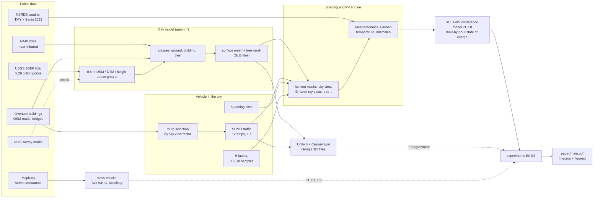
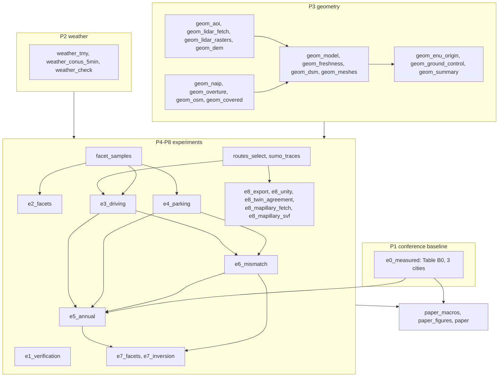

<div align="center">

# SOLARIS-Twin

**A digital twin for shading-aware assessment of vehicle-integrated photovoltaics on a heavy electric vehicle**

[](https://doi.org/10.5281/zenodo.23896001)
[](LICENSE)


[](paper/main.pdf)


<sub>The Unity twin replaying a simulated trip through downtown Phoenix, 21 June, 12:05 MST. The panel on the right shows which facets are in direct sun; under the bridge every facet goes dark. Full clip: <a href="docs/readme/twin_drive.mp4">twin_drive.mp4</a>.</sub>

</div>

Solar panels on a car are usually judged as if the whole skin were a flat roof under an open sky. In a real city the panels face different directions, buildings and trees shade them, and the car spends most of the day parked wherever its owner leaves it. SOLARIS-Twin measures how much of the solar energy survives all of that.

It extends the SOLARIS conference toolkit (an hour-by-hour energy model of a 2.5 t, seven-seat electric vehicle) with a lidar-built 3D model of central Phoenix, Arizona. The vehicle drives traffic-simulated trips on real arterials, parks at five sites, and the shadow on each of its five PV facets is computed every second while driving and every five minutes while parked, for a whole typical year.

> [!NOTE]
> This repository is the code and data pipeline behind the journal manuscript *"A Digital Twin for Shading-Aware Assessment of Vehicle-Integrated Photovoltaics on a Heavy Electric Vehicle"* (A. Kumar, A. Gaikwad, A. Deo), submitted to the IEEE Transactions on Transportation Electrification. It extends our ITEC-AP 2026 conference paper. Every number in [`paper/main.pdf`](paper/main.pdf) is written by a Snakemake rule from the files in [`results/`](results/).

## Results at a glance

| | Phoenix, 50 km/day |
|---|---|
| Solar self-sufficiency of the conference model (whole skin flat, never shaded) | **0.832** |
| ... with the five facets facing where they really face | **0.677** |
| ... for a suburban commuter after parking shade, driving shade and electrical mismatch | **0.512** |
| ... for a car parked at a downtown street-canyon curb | **0.256** |
| Share of the shading loss that happens while parked (commuter / downtown) | **92 % / 95 %** |
| Shading-aware design equation vs. the full simulation | **within 2.6 %** |
| Unity ray-casting twin vs. the Python shading engine | **99.1 % agreement over 15.5 million sample-seconds** |

*Self-sufficiency* is the share of the vehicle's yearly energy demand that it covers on board (PV plus small thermoelectric and suspension-recovery terms). Parking, not driving, decides most of the outcome: the street canyon costs at most 0.017 while driving.

## How the twin is built

The same 1 km block of downtown Phoenix at each stage of the pipeline (Blender renders of the pipeline's own files; the sun is placed for 21 December, 15:00 MST).

<table>
<tr>
<td width="50%"></td>
<td width="50%"></td>
</tr>
<tr>
<td><b>1. Lidar.</b> USGS 3DEP airborne lidar, 5.28 billion points over 952 tiles of 500 m (14 × 17 km), cleaned and reprojected with PDAL. Colour: height above ground.</td>
<td><b>2. Classification.</b> Each 0.5 m cell becomes ground, building or tree from the lidar height and NAIP near-infrared imagery (NDVI). Downtown has few trees: about 1 % of this block.</td>
</tr>
<tr>
<td></td>
<td></td>
</tr>
<tr>
<td><b>3. Surface mesh.</b> A 0.5 m surface model checked against 87 NGS survey marks (median absolute deviation 0.14 m), with building changes since the lidar epoch reviewed against Overture footprints, then meshed per tile.</td>
<td><b>4. Trees kept separate.</b> Canopy is a second mesh because leaves let some light through (transmittance τ), while buildings block it completely.</td>
</tr>
<tr>
<td></td>
<td></td>
</tr>
<tr>
<td><b>5. Visual twin.</b> Unity 6 with Cesium streams Google Photorealistic 3D Tiles over the same coordinates (ENU origin 33.4484° N, 112.0740° W), so the scene looks like the city while the shading still comes from the lidar mesh.</td>
<td><b>6. Replay.</b> The twin replays the exact trips and sun positions of the simulation. Its own ray casts are an independent check of the Python engine (E8).</td>
</tr>
</table>

### Sun and shade over a day

<table>
<tr>
<td width="62%"></td>
<td>The sun position for every second of the year comes from the NREL solar position algorithm (pvlib). Each facet sample gets a horizon mask from the surface model; the beam is blocked when the sun is behind it, and diffuse light is scaled by the sky view factor. On 21 June the sun stands 79° high at noon, so even narrow canyons get light at midday; morning and evening are where buildings take it away.</td>
</tr>
</table>


Weather is the NSRDB typical meteorological year for the cell over downtown Phoenix (TMY-2023, hourly). Temperature matters as well as sunlight: cell temperature follows the Faiman model with the vehicle's speed added to the wind.

## Routes, traffic and parking

Click the routes and sites for their properties. GitHub renders this map from the GeoJSON below.

```geojson
{{GEOJSON}}
```

| Route | Street | Length | Why it was picked |
|---|---|---|---|
| R-OPEN | Southern Avenue, E-W | 8.3 km | highest mean sky view factor (0.96) of 128 candidate arterial windows |
| R-MIXED | 19th Avenue, N-S | 7.8 km | most variable sky view in the middle band |
| R-DENSE | Central Avenue, N-S | 7.8 km | lowest mean sky view factor (0.74), through the high-rise core |
| R-TUNNEL | I-10 Deck Park Tunnel, E-W | 5.6 km | covered-road check (822 m under deck) |

 

Traffic comes from SUMO on the OSM network: background demand at three levels, five departure times (08:00 to 16:00) and both directions, giving 120 frozen trips with a position and speed every second. The vehicle parks at five sites: an open lot (P1), the darkest curb on Central Avenue (P2, sky view factor 0.34), a residential driveway beside a tree (P3), a garage top deck (P4) and the P1 stall under a shade roof (P5).

### A day in the life of each archetype

```mermaid
gantt
    title Where the four archetypes are on a weekday (weekends: at P3, or at P1 for A4)
    dateFormat HH:mm
    axisFormat %H:%M
    todayMarker off
    section A1 commuter
    driveway P3   :00:00, 08:00
    drive              :milestone, 08:00, 0d
    open lot P1        :08:00, 17:00
    drive              :milestone, 17:00, 0d
    driveway P3   :17:00, 23:59
    section A2 downtown street
    driveway P3   :00:00, 08:00
    drive              :milestone, 08:00, 0d
    canyon curb P2     :crit, 08:00, 17:00
    drive              :milestone, 17:00, 0d
    driveway P3   :17:00, 23:59
    section A3 downtown shaded
    driveway P3   :00:00, 08:00
    drive              :milestone, 08:00, 0d
    shade roof P5      :active, 08:00, 17:00
    drive              :milestone, 17:00, 0d
    driveway P3   :17:00, 23:59
    section A4 fleet, 100 km/day
    open lot P1        :00:00, 08:00
    curb P2            :crit, 08:00, 10:00
    open lot P1        :10:00, 12:00
    curb P2            :crit, 12:00, 14:00
    open lot P1        :14:00, 16:00
    curb P2            :crit, 16:00, 17:00
    open lot P1        :17:00, 23:59
```



<sub>Diamonds are trips (A4 also drives at 08, 10, 12, 14 and 16 h). A trip hour drives the first part of the hour and parks for the rest. Source: <a href="configs/schedules/archetypes.yaml">configs/schedules/archetypes.yaml</a>.</sub>

## The vehicle and its five PV facets

<table>
<tr>
<td width="50%"></td>
<td width="25%"></td>
<td width="25%"></td>
</tr>
</table>

| Facet | Colour above | Area (m²) | Tilt | Faces |
|---|---|---|---|---|
| Roof | amber | 4.4 | 2° | up |
| Hood | blue | 1.6 | 10° | forward |
| Tailgate | purple | 0.6 | 60° | rear |
| Left side | green | 2.5 | 85° | left |
| Right side | red | 2.5 | 85° | right |
| **Total** | | **11.6** | | |

The layout is the study's assumed design ([`configs/vehicle/solaris_p0.yaml`](configs/vehicle/solaris_p0.yaml)); roof only (4.4 m²) is reported as the lower bound. Each facet is sampled every 0.25 m, and the samples' shading feeds an electrical mismatch model with bypass diodes. Drag to rotate the facet model the engine uses (grey body, facets offset 3 cm):

```stl
{{STL}}
```

<details>
<summary>A 300 m street canyon around the P2 curb as a 3D model</summary>

[`docs/readme/canyon_p2.stl`](docs/readme/canyon_p2.stl) is the lidar surface (buildings plus tree canopy, 2 m cells) for 150 m around the curb on Central Avenue where the downtown archetype parks. Open it on GitHub to rotate and zoom it.

</details>

## Architecture



Python computes every reported number. The Unity twin, SOLWEIG and the Mapillary panoramas are independent checks only.

<details>
<summary>The Snakemake pipeline, stage by stage</summary>



</details>

## The model in two equations

The conference model's PV harvest, with the irradiance $G$ replaced by what facet $f$ actually receives:

$$
E_{\mathrm{pv}}=A\,\eta_{\mathrm{pv}}\,\kappa_{\mathrm{pv}}\,\frac{G}{1000}\left[1+\beta\,(T_c-25)\right]
$$

$$
G_f=\bar v_{b,f}\,G_{b,f}+\mathrm{SVF}_f\,G_{d,f}+\bar v_{h,f}\,G_{h,f}+G_{g,f}
$$

The Perez model splits sunlight into beam $G_b$, isotropic sky $G_d$, horizon band $G_h$ and ground reflection $G_g$. $\bar v_{b,f}$ is the mean beam state over the facet's samples (1 if the ray to the sun is clear, $\tau = 0.03$ through tree canopy, 0 behind a building), $\mathrm{SVF}_f$ the facet's cosine-weighted sky view factor with trees counted as partly transparent, and $\bar v_{h,f}$ the same over the lowest 6° of sky. All three view terms are 1 in open sky; on covered road all four terms are 0. Cell temperature follows Faiman, $T_c=T_a+G_f/(u_0+u_1 w)$, with the vehicle speed added to the wind $w$. The conference design equation, extended with a shading factor per archetype and solved for the skin area, stays within 2.6 % of the full simulation (3.3 % if the vehicle mass is held fixed).

## Experiments

<details>
<summary><b>E0 - Reproduce the conference baseline</b> (Phoenix 0.832, Lucknow 0.713, London 0.517)</summary>

The conference code v1.1.0 is kept byte-identical in [`src/solaris/legacy/`](src/solaris/legacy/) (SHA-256 checked by a pre-commit hook), and the refactored core reproduces every output. Table B0 gives self-sufficiency, grid charges, design area and range for three cities on satellite typical years. Code: [`experiments/e0_reproduce/run.py`](experiments/e0_reproduce/run.py).

</details>

<details>
<summary><b>E1 - Verify the shading engine</b> (40 of 40 tests, 98.0-99.3 % agreement with SOLWEIG)</summary>

Engine tests cover sun position, transposition, shadow length and canyon sky view factor. The raster horizon and the mesh ray caster agree on the beam state for 99.6 % of 1,000 points at 43 sun positions, with a mean sky-view difference of 0.008. SOLWEIG shadow maps agree on 98.0-99.3 % of pixels at 12 times. Code: [`experiments/e1_verify/run.py`](experiments/e1_verify/run.py).


</details>

<details>
<summary><b>E2 - Facet orientation</b> (the five facets harvest 0.805 of a flat skin)</summary>

The sides are nearly vertical, so they collect far less than a roof of the same area. The five facets harvest 0.805 of the PV energy of the same 11.6 m² laid flat (self-sufficiency 0.836 for the flat skin with Faiman cooling); the thermoelectric and suspension terms do not change. Code: [`experiments/e2_facets/run.py`](experiments/e2_facets/run.py).


</details>

<details>
<summary><b>E3 - Driving shade</b> (R-DENSE keeps 0.71 of the open-sky energy)</summary>

Every facet sample is shaded once per second along all 120 trips, each driven on 21 March, June, September and December. R-OPEN and R-MIXED lose least; the high-rise core of R-DENSE keeps 0.71 of the open-sky energy, and the two tunnel trips keep 0.67 and 0.79. Code: [`experiments/e3_driving/run.py`](experiments/e3_driving/run.py).


</details>

<details>
<summary><b>E4 - Parking shade</b> (P1 0.94, P4 0.88, P5 0.64, P3 0.45, P2 0.32)</summary>

Each site is evaluated every five minutes for a year at four headings (two at the curb). The canyon curb P2 keeps 0.32 of the open-sky energy. SOLWEIG site maps agree on at least 96.7 % of pixels. Code: [`experiments/e4_parking/run.py`](experiments/e4_parking/run.py).

</details>

<details>
<summary><b>E5 - A full year for four archetypes</b> (the loss waterfall)</summary>

| Step | A1 commuter | A2 downtown street | A3 downtown shaded | A4 fleet |
|---|---|---|---|---|
| Conference baseline | 0.832 | 0.832 | 0.832 | 0.419 |
| Facet orientation | 0.677 | 0.678 | 0.676 | 0.345 |
| Parking shade | 0.552 | 0.308 | 0.420 | 0.271 |
| Driving shade (buildings, trees) | 0.542 | 0.290 | 0.402 | 0.261 |
| Electrical mismatch | **0.512** | **0.256** | **0.335** | **0.257** |

A4 drives 100 km/day, so its baseline is lower. Code: [`experiments/e5_annual/run.py`](experiments/e5_annual/run.py).


</details>

<details>
<summary><b>E6 - Electrical mismatch</b> (0.96 in the canyon, 0.56-0.73 under the tree at P3)</summary>

Partial shade costs more than its area: each facet is one module on its own MPPT input with three bypass-diode substrings, and one shaded cell already pushes its substring through the diode. Energy-weighted, the mismatch factor is 0.96 on the R-DENSE trips and at the curb, where whole facets fall into building shadow, but 0.56 to 0.73 in the dappled shade of the tree at P3. Code: [`experiments/e6_mismatch/run.py`](experiments/e6_mismatch/run.py).


</details>

<details>
<summary><b>E7 - Shading-aware design equation</b> (within 2.6 % of the simulation)</summary>

The conference design equation is extended with the archetype's shading factors and solved for the skin area that reaches a target self-sufficiency; a sweep over area (8 to 20 m²), layout (roof, roof + hood, full skin), κ and the four archetypes checks it against the full simulation. Code: [`experiments/e7_inversion/run.py`](experiments/e7_inversion/run.py).


</details>

<details>
<summary><b>E8 - Cross-verification</b> (Unity 99.1 %, Mapillary sky view MAE 0.054)</summary>

The Unity twin ray-casts the same trips independently and agrees with the Python engine on 99.1 % of 15.5 million sample-seconds. Sky view factors from seven Mapillary street panoramas match the engine with a mean absolute error of 0.054 (r = 0.92). Code: [`experiments/e8_validation/run.py`](experiments/e8_validation/run.py).


</details>

## Reproduce

Everything runs natively on Windows 11 (Linux works the same way). Install [Miniforge](https://conda-forge.org/download/), then in a Miniforge Prompt:

```bat
git clone https://github.com/jarvisxys/solaris-vipv.git
cd solaris-vipv
conda env create -f environment.yml
conda activate solaris
projsync --file us_noaa_g2018u0.tif
```

```bash
pytest -q            # 568 regression and verification tests
snakemake -n         # dry run of the whole DAG
snakemake -c8 all    # fetch, build the city, run E0-E8, write the paper
snakemake -c1 paper  # only rebuild paper/main.pdf from results/ (needs pdflatex)
```

Input data is public but not redistributed (about 30 GB of lidar and imagery). [`data/README.md`](data/README.md) lists every source and the rule that fetches it; NSRDB downloads need a free NREL API key. The summary tables in `results/` are committed, so the paper builds without the raw data.

The Unity project in [`twin/unity/`](twin/unity/) (Unity 6.3 LTS, Cesium for Unity) reads the exchange files in [`twin/exchange/`](twin/exchange/); streaming Google tiles needs your own Cesium ion token.

<details>
<summary>Repository layout</summary>

| Path | Contents |
|---|---|
| `configs/` | `base.yaml` (conference parameters, frozen), site, vehicle, schedules, experiments, paper |
| `src/solaris/` | `legacy/` (conference code, byte-identical), `core/`, `weather/`, `geometry/`, `vehicle/`, `trajectory/`, `shading/`, `pv/`, `twin_io/`, `paper.py` |
| `geom/` | QGIS review helper for the building-change step |
| `routes/v1`, `routes/v2` | frozen route and parking GeoJSON with SHA-256 manifests (v2 is used; v1 was selected on a surface model with power-line artefacts) |
| `experiments/` | `e0_reproduce/` ... `e8_validation/` |
| `results/` | summary tables and JSON (large outputs are not committed) |
| `twin/` | Unity project, Blender build scripts for the vehicle, Python-Unity exchange schema |
| `paper/` | journal LaTeX, generated macros and figures, `main.pdf` |
| `docs/readme/` | the images and 3D files of this page; `make_figures.py` and `blender_renders.py` rebuild them |
| `PAPER_CHANGELOG.md` | every decision that changed a reported number |

</details>

## Data and attributions

| Source | Use | License |
|---|---|---|
| USGS 3DEP lidar (AZ_MaricopaPinal_2020_B20) | city geometry | public domain |
| USDA NAIP 2021 | tree/building separation (NDVI) | public domain |
| NREL NSRDB (TMY-2023, 5-min 2023) | weather | NREL terms of use |
| NGS survey marks | ground check | public domain |
| Overture Maps buildings | building changes | ODbL |
| OpenStreetMap | roads, bridges, tunnels, SUMO network | ODbL, © OpenStreetMap contributors |
| Mapillary | street panoramas for sky view | CC BY-SA 4.0 |
| Google Photorealistic 3D Tiles via Cesium ion | Unity visuals only (screenshots above keep the on-screen attribution) | Google Maps Platform terms |
| SOLWEIG / UMEP | external cross-check only, never linked | GPL-3.0 |

## Citation

If you use this code, please cite the archived release and the conference paper (the journal paper is under review):

```bibtex
@software{kumar_solaris_twin_2026,
  author    = {Kumar, Aditya and Gaikwad, Anandsagar and Deo, Arjun},
  title     = {{SOLARIS-Twin: Digital twin pipeline for shading-aware assessment of vehicle-integrated photovoltaics}},
  version   = {v2.0.0-journal},
  year      = {2026},
  publisher = {Zenodo},
  doi       = {10.5281/zenodo.23896001},
  url       = {https://doi.org/10.5281/zenodo.23896001}
}

@inproceedings{gaikwad_solaris_2026,
  author    = {Gaikwad, Anandsagar and Kumar, Aditya and Deo, Arjun},
  title     = {{SOLARIS}: A first-principles, drive-cycle- and climate-resolved methodology and open toolkit for assessing solar-assisted heavy electric vehicles},
  booktitle = {IEEE Transportation Electrification Conference and Expo, Asia-Pacific (ITEC-AP 2026)},
  address   = {Busan, Republic of Korea},
  year      = {2026},
  note      = {Accepted}
}
```

GitHub's "Cite this repository" button reads [`CITATION.cff`](CITATION.cff).

## Authors

- **Aditya Kumar**, Rajiv Gandhi Institute of Petroleum Technology (RGIPT), [ORCID 0009-0003-5178-0465](https://orcid.org/0009-0003-5178-0465), corresponding author
- **Anandsagar Gaikwad**, RGIPT, [ORCID 0009-0001-6545-1705](https://orcid.org/0009-0001-6545-1705)
- **Arjun Deo**, RGIPT Bengaluru Campus

The conference toolkit lives at [Anandsagar18/Solaris](https://github.com/Anandsagar18/Solaris). An AI assistant (Claude, Anthropic) helped write and debug code and draft text; the authors designed the study, checked every result and are responsible for the content.

## License

[MIT](LICENSE). SOLWEIG/UMEP (GPL-3.0) is only ever called as an external tool.
